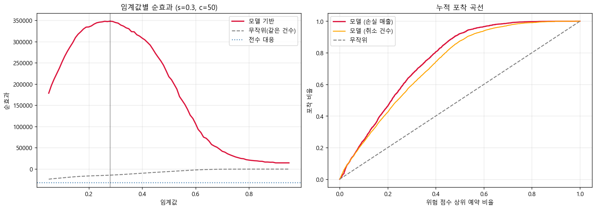

# 호텔 예약 데이터 분석: 취소 예측, 수요 예측, 매출 예측

포르투갈 소재 두 호텔(City Hotel, Resort Hotel)의 예약 데이터(`hotel_bookings.csv`, 예약 1건 = 1행)로 **취소 예측, 일별 수요 예측, 일별 매출 예측**을 수행하고, 취소 예측을 **비즈니스 의사결정**(어떤 예약에 먼저 대응할 것인가)과 **수요 예측의 입력 정의**로 연결한 프로젝트입니다.

시계열 데이터이므로 "예측 시점에 알 수 없는 정보가 섞이지 않았는가"를 계속 점검했고, 그 과정에서 설계를 여러 번 고쳤습니다. 이 문서는 **고친 뒤의 최종 결과**를 중심으로 쓰고, 틀린 정의 위에서 나온 과거 수치는 3.4장과 4장에서 비교용으로만 남겼습니다.

데이터 출처: Antonio, N., de Almeida, A., & Nunes, L. (2019). Hotel booking demand datasets. *Data in Brief*, 22, 41-49.

## 프로젝트 흐름

```
1. EDA ─ 취소·수요 신호 탐색, 가짜 신호 의심 (agent 1 + 포르투갈 쏠림)
      │
      ▼
2. 취소 예측 ─ 예약 시점 변수만으로 LightGBM (Test AUC 0.827)
      │         ├─ 편향 점검: 포르투갈 의존도, 집단 간 이전
      │         └─ 비즈니스 효과: 어떤 예약에 먼저 대응할 것인가 (+348K)
      │
      ▼  "취소가 확정된 예약은 투숙 7일 전에 이미 알 수 있다"
3. 수요·매출 예측 ─ 중첩 walk-forward로 선택 절차 전체를 검증
      │         ├─ 베이스라인 → OTB 정의 오류 발견 → 운영 시점 정의로 수정 (오차 30~55% 감소)
      │         └─ 시점 민감도, 오차 분해, 단순 기준과의 비교
      ▼
4. 정정 이력과 한계 ─ 예측 시점에 알 수 있는 정보만 썼는가를 반복 점검
```

한 줄 요약: **취소 분석에서 나온 "이미 취소된 예약은 빼고 센다"는 입력 정의가, 어떤 모델 개선보다 수요·매출 예측을 크게 개선했습니다.**

## 핵심 요약

### 최종 결과

| 과제 | 기준선 | 최종 결과 | 비고 |
|---|---|---|---|
| 취소 예측 (Test AUC) | 로지스틱 0.758 | **LightGBM 0.827** | 예약 시점에 알 수 있는 변수만 사용. 처음 보고한 0.858은 예약 이후 변수가 섞인 값이라 정정 |
| 취소 대응의 순효과 | 전수 대응 −32K | **+348K** | 성공률 30%, 건당 비용 50 가정. 포르투갈을 빼도 +226~228K |
| City 수요 (바깥 168일 MAPE) | 계절 naive 0.243 | **0.062** | 7일 전 예측 |
| Resort 수요 | 0.357 | **0.124** | |
| City 매출 | 0.251 | **0.044** | |
| Resort 매출 | 0.394 | **0.062** | |

### 핵심 인사이트

1. **가장 큰 개선은 모델이 아니라 입력 정의에서 나왔습니다.** 수요 예측의 OTB(투숙 전에 이미 잡혀 있는 예약)를 처음에는 `lead_time >= 7`인 예약 전부로 셌는데, 그중 **약 38%는 투숙 7일 전에 이미 취소가 확정된 예약**이었습니다. 취소 날짜로 이들을 빼자 모든 과제에서 오차가 **30~55% 줄었습니다.** 이 정의는 취소 분석에서 나왔습니다.
2. **모델 종류와 피처 추가는 큰 변수가 아니었습니다.** 수요, 매출에서는 모델 6개 추가가 기존 9개 모델의 선택 절차를 이기지 못했고, 순증 타깃과 막판 예약 피처는 단순 기준(활성 OTB + 최근 평균 순증)을 통계적으로 이기지 못했습니다. 취소 예측에서는 CatBoost, 시간순 인코딩, 추가 피처가 AUC를 약 ±0.002 안에서만 움직였습니다.
3. **"활성 OTB + 최근 28일 평균 순증"이라는 단순 기준이 선택된 모델과 구분되지 않습니다.** 7일 전에 수요의 83~96%가 이미 알려져 있고, 남은 불확실성은 취소(3~4%)보다 직전 신규 예약(7~21%)에서 옵니다. 이 신호는 예약 데이터 안에서는 설명되지 않았습니다.
4. **취소 대응의 이익은 대상을 좁힐 때만 나오고, 키운 것은 확률이 아니라 선택 규칙이었습니다.** 모델로 고르면 +348K, 전수 대응은 −32K. 예약 금액까지 반영한 기대값 규칙은 같은 모델로 338K에서 414K로 올렸습니다(사후 분석).
5. **취소 모델은 포르투갈 하나에 의존하지 않지만 국적 구성에는 의존합니다.** 포르투갈을 뺀 AUC는 0.819이지만, 한쪽 집단으로 학습하면 다른 집단에서 AUC 0.51~0.54(거의 무작위)입니다.
6. **이 프로젝트는 자기 결과를 여러 번 정정했습니다**(4장). 모두 "예측 시점에 알 수 있는 정보만 쓰는가"를 점검한 결과입니다.

### 활용 방향

- **쓸 수 있는 곳:** City 수요(오차 약 6%)와 매출(약 4%)은 인력 배치, 재고, 가격 정책에 쓸 수 있는 수준입니다. 취소 위험이 높은 예약에 먼저 대응하는 데도 쓸 수 있습니다.
- **조심할 곳:** 취소 대응 이익은 비용과 성공률 가정에 기대므로 A/B 테스트가 필요합니다. Resort 수요(오차 약 12%)는 City보다 불확실합니다. 모든 수치는 예측 시점 7일 전이라는 설계 가정 아래의 값입니다.

### 읽는 법

| 용어 | 뜻 |
|---|---|
| 순수요 | 취소를 제외한 실제 투숙 수. 일별 총예약 평균은 150.6건이지만 실투숙은 94.8건 |
| OTB (on-the-books) | 투숙일 n일 전 시점에 이미 잡혀 있는 예약. **운영 시점 정의**는 `lead_time >= n`이면서 "그 시점까지 취소가 확정되지 않은 예약" |
| MAPE | 일별 절대 백분율 오차(\|실제 − 예측\| ÷ 실제)의 평균. 매출은 분모에 최소 1 적용. 수요가 적은 날의 오차가 크게 반영됨 |
| WAPE | 절대 오차의 합 ÷ 실제값의 합. 날짜별 비율이 아니라 전체 합으로 계산해 수요가 적은 날에 덜 흔들림 |
| 바깥 168일 | 3.3장의 중첩 검증에서 선택에 한 번도 쓰이지 않은 마지막 56일 × 3구간 (2017-03-17 ~ 08-31) |
| 순증 (pickup) | 투숙 7일 전 이후에 더해진 순변화 = 직전 7일 신규 예약 − 그 뒤 취소 |

## 1. EDA (Part 1)

> [EDA.ipynb](EDA.ipynb)

### 1.1 기본 구조와 정리

119,390건 × 32컬럼, 투숙일 2015-07-01 ~ 2017-08-31(793일). 호텔별로 따로 모델링했습니다.

| 컬럼 | 결측 수 | 처리 |
|---|---|---|
| children | 4 | 0으로 대체 |
| country | 488 | `Unknown`으로 대체 |
| agent | 16,340 | 0(여행사 미경유)으로 대체, **ID 자체를 피처로 사용** |
| company | 112,593 (94%) | 컬럼 제거 |

- **agent 결측은 "직접예약" 신호가 아닙니다.** 결측 그룹은 Direct 37%, Corporate 28%, Groups 25%였지만 `market_segment == Direct`와 일치하지 않았습니다(Direct인데 agent가 있는 경우 6,599건, agent가 없는데 Direct가 아닌 경우 10,333건). 대신 여행사별 취소율이 13~73%로 크게 달라 ID를 타깃 인코딩해서 썼습니다(고유값 333개).
- **adr 이상치:** adr ≤ 0이 1,960건(무료 투숙 680건은 정당, 나머지 1,280건은 오류 추정), adr > 1000이 1건. 취소된 예약에도 adr이 있어 adr은 **예약 시점에 합의된 가격**입니다. 매출 분석에서는 `0 < adr < 1000`만 사용하고, 취소 예측에서는 adr = 0도 유효하게 두었습니다.

### 1.2 취소 신호: 강한 신호를 의심하기

| 변수 | 값 | 취소율 |
|---|---|---|
| lead_time | 0~7일 / 8~30 / 31~90 / 91~180 / 180일 초과 | 9.6% / 27.9% / 37.7% / 44.7% / **57.0%** |
| market_segment | Direct / Corporate / Offline TA/TO / Online TA / Groups | 15.3% / 18.7% / 34.3% / 36.7% / **61.1%** |
| deposit_type | No Deposit / Non Refund | 28.4% / **99.4%** (역설적) |
| previous_cancellations | 0회 / 1회 이상 | 33.9% / **91.6%** |

`deposit_type`과 `previous_cancellations`는 너무 강해서 가짜 신호를 의심하고 파고들었습니다.

- previous_cancellations는 1회 94.4%, 2회 32.8%, 3회 30.8%로 **단조 증가하지 않고**, 1회 그룹(6,051건)의 95.7%가 포르투갈입니다.
- Non Refund 14,587건 중 99%가 취소였고 이 중 99%가 포르투갈 고객입니다. "보증금 때문에 취소가 많다"가 아니라 특정 채널, 국가의 비정상 패턴일 가능성이 큽니다.
- **범인 후보는 agent 1 + 포르투갈입니다.** agent 1은 7,191건(취소율 73.4%, 그중 포르투갈 83.9%, Non Refund 56.6%)이고 2015년 7~10월에 집중됩니다. 포르투갈은 전체의 40.7%이며 취소율 56.6%(비포르투갈 23.6%).
- Groups는 agent 1을 빼도 취소율 54.0%로 남아 **신뢰할 수 있는 신호**입니다.

| 구분 | 변수 | 판단 |
|---|---|---|
| 신뢰 | lead_time, market_segment | 시간 흐름과 agent 1 제거에도 안정적 |
| 편향 의심 | deposit_type, previous_cancellations | agent 1 + 포르투갈 쏠림. 2장에서 제외 실험으로 영향 측정 |

### 1.3 수요 신호: 무엇을 예측할지 정하기

- **호텔 분리 필요:** City는 우상향에 계절 변동이 크고 Resort는 비교적 평탄합니다. 두 호텔 모두 금/토가 높고 화요일이 가장 낮습니다.
- **총예약 ≠ 실제 수요:** 일별 취소율 평균 34%(2~87%). 예측 타깃은 **순수요(실제 투숙 수)** 로 정했습니다.
- **리드타임 구조:** 중앙값 69일, 예약의 약 43%가 91일 이상 전에 이뤄집니다. 투숙 훨씬 전에 예약이 쌓여 있어 "투숙 N일 전의 예약 수"가 강한 단서가 됩니다.
- **자기상관(City 순수요):** lag 7일 0.420, lag 14일 0.381로 주간 주기가 가장 강합니다. "지난주 같은 요일"을 베이스라인으로 삼았습니다.
- **매출:** Resort는 투숙 수가 평탄한 대신 투숙당 매출이 8월 800~990, 1월 120~150으로 계절에 따라 6배 차이 납니다. **Resort의 매출 변동은 수요보다 가격이 만듭니다.**
- 2015-07은 수집 시작 시점이라 예약이 덜 잡혀 있어 수요 예측에서 제거했습니다.

### 1.4 가격대, 룸 유형 탐색 (price_room_eda.py)

> [price_room_eda.py](scripts/price_room_eda.py)

가격대는 호텔별 adr 3분위(City 경계 88, 116 / Resort 60, 104)이고, 계절 효과를 분리하려고 **같은 달 안에서의 상대 가격대**도 함께 봤습니다(유효 가격 예약만).

| 지표 | City 저/중/고 | Resort 저/중/고 |
|---|---|---|
| 취소율 (전체 3분위) | 0.438 / 0.416 / 0.413 | 0.231 / 0.281 / 0.332 |
| 취소율 (월내 상대) | 0.449 / 0.418 / 0.397 | 0.245 / 0.288 / 0.311 |
| 막판 예약 비중 (리드타임 7일 미만, 취소 제외, 전체 3분위) | 0.188 / 0.162 / 0.192 | 0.367 / 0.225 / 0.188 |
| 막판 예약 비중 (월내 상대) | 0.160 / 0.157 / 0.223 | 0.273 / 0.261 / 0.263 |

- **취소율은 가격대에 따라 호텔마다 반대 방향입니다.** City는 비쌀수록 약간 낮고(0.449 → 0.397), Resort는 비쌀수록 높습니다(0.245 → 0.311, 계절을 통제해도 유지). 룸 유형은 Resort G, H가 41%, F가 16%로 차이가 크고 City는 A 44% 대 D, E 33~36%입니다. 취소 모델은 adr와 룸 유형을 이미 입력으로 쓰고 있습니다.
- **막판 예약 비중은 가격대로 설명되지 않습니다.** Resort는 전체 기준으로 싼 방이 막판 예약이 많아 보이지만(0.367 대 0.188) 이는 계절 효과(겨울이 싸고 리드타임이 짧음)이고, 같은 달 안에서는 0.26~0.27로 평평합니다. City는 월내 상대 고가대에서만 0.223으로 높고, 시장 세그먼트를 통제해도 방향이 호텔마다 일정하지 않습니다(City Groups 0.049 → 0.168은 건수가 적음). 룸 유형별 차이(Resort A 31% 대 D, E 18~19%)는 계절을 통제하지 않은 값입니다.
- **Resort는 계절에 따라 가격대 구성이 극적으로 바뀝니다.** 고가대 비중이 1월 1%에서 8월 95%로, 저가대는 77%에서 1%로 움직이고 adr 중앙값은 48 → 189입니다. 룸 유형 구성은 이만큼 바뀌지 않아(A형 72% → 45%) 같은 방의 **가격 자체가 계절에 따라 변하는 것**입니다. 절대 가격대는 사실상 월의 대리 변수라서 수요 예측에 따로 넣을 이유가 없습니다.
- 성수기(7~8월) Resort는 고가대 취소율이 0.341로 가장 높고, 비수기(11~2월)는 고가대가 0.171로 낮아 **가격과 취소의 관계가 계절에 따라 뒤집히는 것처럼 보입니다.** 비수기의 고가대는 건수가 매우 적어 확정하지 못했습니다.

**결론:** 막판 신규 예약의 날짜별 변동을 가격대, 룸 유형으로 설명할 수 있다는 근거는 이 탐색에서 나오지 않았습니다. 이는 부록 D.1에서 평균 adr와 세그먼트 비중을 넣어도 단순 기준을 이기지 못한 결과와 일치합니다. 가격대는 취소 예측에서 호텔별로 다르게 작용하는 신호로만 의미가 있고, 이미 모델에 들어 있습니다.

## 2. 취소 예측과 대응 효과 (Part 2, 2-1)

> [Part2_cancel_prediction.ipynb](Part2_cancel_prediction.ipynb), [Part2_1_cancel_business_impact.ipynb](Part2_1_cancel_business_impact.ipynb)

### 2.1 취소 예측 모델

**설계:** 예약일(투숙일 − 리드타임) 기준 시간순 분할 70/15/15.

| 구분 | 예약일 기간 | 건수 | 취소율 |
|---|---|---|---|
| train | ~ 2016-11-06 | 83,580 | 38.0% |
| valid | 2016-11-07 ~ 2017-02-03 | 18,041 | 40.0% |
| test | 2017-02-04 ~ 2017-08-31 | 17,769 | 29.6% |

- agent는 스무딩 타깃 인코딩(train에서만 계산, m=100), country는 상위 20개 + `Other`.
- **제거한 컬럼:** 결과 자체(`reservation_status`, `reservation_status_date`), 체크인 시점에 확정되는 값(`assigned_room_type`, `required_car_parking_spaces`), 절대 날짜, company, **예약 이후 값이 쌓이는 최종값**(`booking_changes`, `total_of_special_requests`, `days_in_waiting_list`), `arrival_date_year`.

| 모델 | Valid AUC | Test AUC |
|---|---|---|
| 다수 클래스(전부 "취소 안 함") | - | 0.500 (정확도 0.704) |
| 로지스틱 회귀 | 0.860 | 0.758 |
| **LightGBM** (early stopping) | **0.897** | **0.827** |

- 중요도 상위: deposit_type, country, lead_time, agent_te, previous_cancellations.
- **agent 1을 빼도 같은 test에서 AUC가 0.8269 → 0.8267**로 차이가 0.001 미만이라, 성능이 agent 1 하나에 기대지 않습니다.
- **Valid 0.897 → Test 0.827 하락은 분포 이동 때문입니다.** test의 취소율이 낮고(29.6%) 리드타임 중앙값이 81일 → 29일로 줄었으며, 데이터가 2017-08-31에 끝나 긴 리드타임 예약이 test에 아직 안 들어왔습니다(우측 절단).

**정정 (0.858 → 0.827):** 처음 버전은 예약 이후에 쌓이는 변수 3개와 `arrival_date_year`를 입력으로 썼습니다. 제외하고 효과를 분리해서 측정했습니다.

| 설정 | 피처 수 | Valid AUC | Test AUC |
|---|---|---|---|
| 제외 전 (처음 Part 2) | 26 | 0.9184 | 0.8560 |
| 예약 이후 변수 3개 제외 | 23 | 0.9017 | 0.8319 |
| `arrival_date_year`만 제외 | 25 | 0.9156 | 0.8510 |
| **3개 + year 제외 (현재)** | 22 | 0.8973 | **0.8271** |

예약 이후 변수가 AUC를 약 0.024, year가 약 0.005 올려 놓았습니다. 처음 보고한 0.858(재실행 0.856)에는 **예약 시점에 쓸 수 없는 정보가 만든 성능**이 섞여 있었고, 현실적인 값은 **0.827**입니다.

### 2.2 편향 점검: 포르투갈 (country_bias_check.py)

> [country_bias_check.py](scripts/country_bias_check.py), [cancel_country_check.csv](results/cancel_country_check.csv)

| 점검 | 포르투갈 | 그 외 | 전체 |
|---|---|---|---|
| test 예약 수 (비중) | 5,247 (29.5%) | 12,522 (70.5%) | 17,769 |
| 실제 취소율 / 예측 평균 | 0.368 / 0.307 | 0.266 / 0.259 | |
| **집단 안에서의 AUC** | 0.844 | 0.819 | 0.827 |
| country를 뺀 모델 AUC | 0.793 (−0.051) | 0.806 (−0.013) | 0.762 (−0.065) |
| 한 집단만 학습 → 다른 집단 평가 | 0.512 | 0.539 | |

- **성능은 포르투갈 하나에서 나온 게 아닙니다.** 국가 집단 평균만 쓰면 AUC 0.551이지만, 집단 안에서는 0.844와 0.819로 비슷하게 높습니다.
- **그래도 국가 정보는 핵심 입력입니다.** SHAP 비중이 deposit_type 21.5%, country 19.1%, agent_te 14.7%, lead_time 8.7% 순이고, 빼면 AUC가 0.065 떨어집니다.
- **집단 간 이전이 안 됩니다.** 한 집단만으로 학습하면 다른 집단에서 거의 무작위입니다. 이 모델은 "범용 취소 모델"이라기보다 **국적별 패턴을 합친 모델**에 가깝습니다. 국적 구성이 다른 호텔로 옮기면 성능을 보장할 수 없습니다.
- 포르투갈의 중간 위험 구간은 과소 예측됩니다(예측 0.41 구간의 실제 취소율 0.57). 학습 구간 포르투갈 취소율 0.589가 test에서 0.368로 변한 시간 변화의 영향으로 보입니다.

### 2.3 모델 개선 실험: 포화 상태 (cancel_improve.py)

> [cancel_improve.py](scripts/cancel_improve.py), [cancel_improve_results.csv](results/cancel_improve_results.csv), [cancel_calibration_results.csv](results/cancel_calibration_results.csv)

LightGBM은 시드 3개 평균입니다. "시간순 TE"는 agent(와 country)의 취소율을 **예약 시점 이전에 결과가 확정된 예약**(취소일 또는 퇴실일이 예약일보다 앞선 것)만으로 시간순 누적 계산한 것입니다.

| 변형 | Test AUC | 기본 대비 [95% CI] |
|---|---|---|
| 기본 (Part 2) | 0.8272 | |
| 시간순 TE (agent) | 0.8253 | −0.0019 [−0.0038, −0.0001] |
| 시간순 TE (agent, country) | 0.8281 | +0.0009 [−0.0012, +0.0030] |
| 시간순 TE + 추가 피처 (숙박일, 인원, 1인당 adr, 예약 월과 요일 등) | 0.8295 | +0.0023 [+0.0002, +0.0043] |
| CatBoost (범주 직접 처리) | 0.8283 | +0.0011 [−0.0015, +0.0031] |

- **모델 쪽 개선은 AUC 0.83에서 ±0.002 안에 머물러 포화**입니다. CatBoost와 타깃 인코딩은 구분되지 않고, 추가 피처의 +0.0023은 변형이 4개라 우연일 수 있어 개선으로 보지 않았습니다.
- **확률 보정(Platt, isotonic):** 보정 오차(ECE)를 0.029 → 0.015~0.017로 줄이고 평균 예측을 맞춥니다(0.273 → 0.297, 실제 0.296). 순위는 바꾸지 않으므로 AUC는 그대로이고, 포르투갈은 보정 후에도 과소 예측입니다(0.331 대 0.368).

### 2.4 취소 대응의 비즈니스 효과 (Part 2-1)

> [business_impact.png](results/business_impact.png), [cancel_threshold_table.csv](results/cancel_threshold_table.csv), [cancel_sensitivity.csv](results/cancel_sensitivity.csv), [cancel_nonrefund_check.csv](results/cancel_nonrefund_check.csv), [country_impact_check.py](scripts/country_impact_check.py), [cancel_country_impact.csv](results/cancel_country_impact.csv)



**질문:** 취소 위험이 높은 예약에 먼저 대응하면 얼마나 이득인가?

**방법:** test 구간(17,769건)에서 평가. 순효과 = Σ(s × 취소될 예약의 매출) − c × 대응 건수. 예약 매출 = adr × 숙박일수. **c(건당 대응 비용)와 s(취소를 막는 성공률)는 데이터에 없어 가정**이므로 값을 바꿔가며 봤습니다. 비교 대상은 모델 기반, 무작위(같은 건수), 전수 대응입니다.

- test 구간에서 취소로 잃은 예상 매출은 **2,854,567로 전체 예상 매출의 36.0%**입니다.
- 위험 점수 상위 10% 예약에 전체 취소의 23.4%, 손실 매출의 24.6%가, 상위 30%에 취소 59.6%, 손실 매출 66.2%가 들어 있습니다(무작위 대비 약 2.2~2.5배).

| 성공률 s | 건당 비용 c | 최적 임계값 | 모델 순효과 | 전수 대응 | 무작위(같은 건수) |
|---|---|---|---|---|---|
| 0.3 | 10 | 0.11 | 723,027 | 678,680 | 436,870 |
| 0.3 | 25 | 0.19 | 570,193 | 412,145 | 219,073 |
| **0.3** | **50** | **0.28** | **348,088** | **−32,080** | **−14,857** |
| 0.3 | 100 | 0.48 | 47,486 | −920,530 | −203,906 |
| 0.2 | 50 | 0.41 | 111,401 | −317,537 | −97,947 |
| 0.1 | 50 | 0.69 | −1,637 | −602,993 | −17,443 |

- **모델의 가치는 비용이 클수록 커집니다.** 대응이 아주 싸면(c = 10) 거의 전부에 대응해도 이득이라 차이가 작고, c ≥ 50에서는 전수 대응이 적자가 되어 모델로 좁혀야만 흑자입니다. 손익분기는 `취소 확률 × s × 취소 예약 평균 매출(약 543) > c`입니다. 성공률이 0.1로 낮으면 비용 50에서는 모델로도 이득이 없습니다.
- **세그먼트:** 손실 매출의 79.8%가 Online TA에서 나오고 이 중 93.9%를 포착합니다. 반면 Direct는 포착률이 38.0%로 낮아 **직접예약 취소는 이 모델이 상대적으로 잘 못 잡습니다.**

**+348K가 흔들리는지 점검** (s = 0.3, c = 50)

| 설정 | 모델 순효과 | 전수 대응 |
|---|---|---|
| 전체 | **+348K** | −32K |
| Non Refund 이상 집단을 평가에서만 제외 | +334K | −46K |
| Non Refund를 학습과 평가에서 모두 제외 (재학습) | +338K | −46K |
| 포르투갈을 평가에서만 제외 | +228K | −41K |
| 포르투갈을 학습과 평가에서 모두 제외 (재학습) | +226K | −41K |

- **효과는 이상 집단이나 포르투갈에 의존하지 않습니다.** 손실 매출 대비 순효과가 0.122에서 0.116~0.123으로 거의 같고, 전수 대응이 손해라는 결론도 같습니다.
- **임계값을 test에서 고른 낙관은 미미합니다.** valid에서 고른 임계값 0.29를 test에 적용해도 347K로 0.2%만 낮습니다.

**대상 선택 규칙: 기대값 규칙 (사후 분석)**

| 대응 대상 선택 | 보정 없음 | Platt | Isotonic |
|---|---|---|---|
| 확률 임계값 (valid에서 선택) | 338K | 335K | 335K |
| **기대값 규칙** (s × 확률 × 예약 매출 ≥ c이면 대응) | **414K** | **417K** | 414K |
| 규칙이 예측한 순효과 | 328K | 375K | 369K |

- 확률 임계값 방식은 예약 금액을 무시하지만, 기대값 규칙은 금액이 큰 예약은 중간 확률에서도, 작은 예약은 높은 확률에서도 제외합니다. **같은 모델로 338K → 414K(약 22%), test에서 고른 최적 임계값(353K)보다도 약 17% 높습니다.** 임계값 튜닝이 필요 없다는 점도 장점입니다.
- **확률 보정은 실현된 순효과를 바꾸지 못하고**(±3K), 이익의 예측 정확도만 높입니다(예측 이익이 실제의 79% → 91%).
- 이 표의 기준 숫자(338K, 353K)가 위쪽의 348K, 347K와 다른 것은 `cancel_improve.py`가 시드 3개 평균 모델을 쓰기 때문입니다. Part 2-1의 348K와 모델 설정이 약간 달라 값이 다르며, 같은 표 안의 비교만 의미가 있습니다.
- 주의: 결과를 본 뒤 시도한 사후 분석이고, 같은 test 기간에서만 확인했으며, 성공률과 비용 가정에 그대로 의존합니다.

## 3. 수요와 매출 예측 (Part 3, 3-1, 4, 4-1, 5)

> [Part3_demand_forecast.ipynb](Part3_demand_forecast.ipynb), [Part3_1_demand_with_eda_features.ipynb](Part3_1_demand_with_eda_features.ipynb), [Part4_revenue_forecast.ipynb](Part4_revenue_forecast.ipynb), [Part4_1_revenue_nested.ipynb](Part4_1_revenue_nested.ipynb), [asof_nested.py](scripts/asof_nested.py), [asof_report.py](scripts/asof_report.py)

**타깃:** 호텔별, 일별 **순수요(취소 제외 투숙 수)** 와 **매출(취소 제외 예약의 adr × 숙박일수, 투숙 시작일 귀속, 유효 가격만)**. 평가 지표는 MAPE, WAPE, 편향입니다.

### 3.1 베이스라인 (Part 3, 4)

단일 70/15/15 분할, 여름 113일 test, 하루 전 예측입니다. 피처는 요일, 월, lag, rolling이고 가장 큰 개선은 **OTB 피처**에서 나왔습니다.

| 단계 | City MAPE | Resort MAPE |
|---|---|---|
| 지난주 같은 요일 (계절 naive) | 0.266 | 0.287 |
| LightGBM (시간, lag, rolling) | 0.188 | 0.224 |
| + OTB | 0.124 | 0.180 |

매출도 같은 방식으로 OTB 예상 매출(이미 잡힌 예약의 adr × 숙박일수)을 더하자 City WAPE가 0.239 → 0.123, Resort 0.260 → 0.151로 줄었습니다. `otb_3`은 투숙 3일 전 예약 수가 사실상 최종 수요를 알려줘 누수 경계라 제거했습니다.

**한계:** 한 구간만 평가했고, `lag_1`(하루 전)과 `otb_7`(7일 전)의 예측 시점이 달랐으며, OTB 정의에 결함이 있었습니다(3.4장). 이 수치들은 최종 결과로 쓰지 않습니다.

### 3.2 문제 정의: 예측 시점과 OTB

- **예측 시점은 투숙 7일 전(H=7)으로 가정**했습니다. 인력 배치와 가격 조정에 일주일 전 예측이 쓸모 있다는 판단이며, 다른 시점의 민감도는 3.5장에서 봅니다.
- 7일 전 시점의 규칙: 수요 이력(lag, rolling)은 8일 전까지만 사용하고, OTB와 구성 피처는 `lead_time >= 7`이면서 **그 시점까지 취소가 확정되지 않은 예약**만 사용합니다(최종 정의는 3.4장. 3.1의 베이스라인과 최초 3-1, 4-1은 취소 확정 예약을 빼지 않은 옛 정의였습니다).

### 3.3 검증 설계: 중첩 walk-forward

데이터가 약 2년뿐이라 한 번의 홀드아웃은 작고 성수기에 치우칩니다. 그래서 **바깥 평가 구간 3개(56일씩, 168일)** 를 두고, 구간마다 **그 이전 데이터만으로** 선택과 튜닝을 처음부터 다시 했습니다.

```
시간 ──────────────────────────────────────────────────────►
바깥 1: [ DEV: 선택, 튜닝, 모델비교 (inner CV) ][ 평가 56일 ]
바깥 2: [ DEV (바깥 1 평가 구간 포함)                 ][ 평가 56일 ]
바깥 3: [ DEV                                                ][ 평가 56일 ]
```

- 각 DEV 안에서 **inner walk-forward(56일 × 4구간)** 로 EDA 피처 그룹 forward selection(개선폭 0.003 미만이면 중단), 하이퍼파라미터와 타깃 방식 튜닝, 모델 선택을 합니다. 호텔별로 따로 선택합니다.
- **평가하는 것은 개별 모델이 아니라 "선택 절차 전체"** 입니다. 최종 수치는 **선택 절차 A**(inner CV MAPE 1위 모델)의 바깥 성능을 이어 붙인 값이고, 이것이 이 프로젝트가 실제로 주장할 수 있는 성능입니다.
- **취소 확률 피처도 시계열 원칙으로:** 투숙일 45일 구간 expanding window로, 구간 k의 확률은 0~k−1 예약만으로 학습한 모델이 계산합니다.
- 겨울(11~2월)은 데이터 길이 때문에 바깥 평가에 포함할 수 없고, DEV 안의 inner CV에만 들어갑니다.
- 신뢰구간은 7일 블록 부트스트랩입니다.

**EDA 발견을 피처 그룹으로:** 모든 피처는 투숙 7일 전에 이미 잡혀 있던 예약(OTB)의 구성입니다.

| 그룹 | 근거 | 피처 |
|---|---|---|
| segment | market_segment별 취소율 | 세그먼트 비중 |
| biased | Non Refund, 포르투갈, agent 1 쏠림 | 해당 비중 |
| history | 이전 취소 이력 고객 취소율 92% | 이전 취소 이력, 재방문 비중 |
| leadtime, price, size | 리드타임, adr(예약 시점 가격), 숙박 규모 | OTB 평균 리드타임, adr, 숙박일수, 인원 |
| attrs | 고객 유형, 식사, 동반자 | 해당 비중 |
| cancel | Part 2 취소 모델 | 기대 순예약 = Σ(1 − 취소확률), 평균 취소 확률 |
| cancel_lag, calendar, trend | 일별 취소율 변동, 공휴일, City 우상향 | 최근 실제 취소율, 공휴일, 최근 수준 |

**비교한 모델 9개:** 계절 naive, ETS, SARIMAX+OTB, Ridge, RandomForest, HistGB, LightGBM(Part 3 설정), LightGBM(튜닝), 블렌드(LGBM+Ridge).

### 3.4 OTB 정의 수정 (Part 5): 가장 큰 개선

3.3의 절차로 처음 돌린 결과(Part 3-1, 4-1)는 City 수요 0.091, Resort 0.186, City 매출 0.100, Resort 매출 0.137이었습니다. 그런데 OTB를 `lead_time >= n`인 예약 전부로 세는 결함이 있었습니다. 예측 시점(투숙 7일 전)에는 그 전에 취소된 예약을 이미 알고 있으므로 세면 안 됩니다.

**운영 시점(as-of) 정의:** `lead_time >= n` **그리고** NOT(취소됨 AND 취소일 ≤ 투숙일 − n일)

| n (투숙 n일 전) | 7 | 14 | 30 | 60 | 90 |
|---|---|---|---|---|---|
| 활성 예약 ÷ `lead_time >= n` 예약 | 0.619 | 0.627 | 0.647 | 0.678 | 0.696 |

- 기존 OTB의 약 **30~38%는 이미 취소가 알려진 예약**이었습니다. 미래 정보가 섞인 누수가 아니라 **알 수 있던 정보를 쓰지 않아 신호가 지저분했던** 문제입니다.
- 데이터 설명서(Antonio 등, 2019)는 `reservation_status_date`를 "마지막 상태가 정해진 날짜이며 `reservation_status`와 함께 쓰면 취소 시점을 알 수 있다"고 설명합니다. 취소일이 예약일보다 빠른 경우 0건, 투숙일보다 늦은 경우 0건, 취소 예약의 87%가 7일 전까지 확정으로 정합성 점검에서도 모순이 없었습니다.
- 기존 정의로 다시 돌린 결과가 Part 3-1의 예측값과 소수점까지 같았으므로(검증 후 해당 캐시는 삭제) 코드 재작성으로 생긴 차이는 없습니다.

**최종 결과: 선택 절차 A, 기존 9개 모델, 바깥 168일 MAPE**

| 과제 | 계절 naive | 기존 정의 | **운영 시점 정의** | 차이 [95% CI] |
|---|---|---|---|---|
| City 수요 | 0.2425 | 0.0910 | **0.0620** | −0.029 [−0.040, −0.018] 유의 |
| Resort 수요 | 0.3567 | 0.1856 | **0.1238** | −0.062 [−0.092, −0.035] 유의 |
| City 매출 | 0.2506 | 0.0999 | **0.0440** | −0.056 [−0.068, −0.043] 유의 |
| Resort 매출 | 0.3937 | 0.1369 | **0.0615** | −0.075 [−0.095, −0.057] 유의 |

- 계절 naive 대비도 모두 유의한 개선입니다.
- 구간별 선택 모델은 정의를 바로잡자 **단순한 모델 쪽으로 이동**했습니다(City 수요: Ridge, Ridge, 블렌드 / Resort 수요: HistGB, 블렌드, 블렌드 / City 매출: Ridge 3회 / Resort 매출: SARIMAX+OTB, 블렌드, 블렌드).

**배포용(최종) 모델 설정** (전체 데이터로 선택, 절차 A): 수요는 **City 블렌드(LGBM+Ridge), Resort LightGBM(튜닝)**, 매출은 **City와 Resort 모두 SARIMAX+OTB**입니다. 다만 상위 모델은 서로 통계적으로 구분되지 않으므로(3.6장에서는 단순 기준과도 구분되지 않음) 이 선택은 "이 모델이 확실히 최고"가 아니라 "사전에 정한 절차의 결과"입니다.

**취소 보정 지표의 효과는 사라졌습니다 (SARIMAX 외생변수 ablation, 바깥 168일 MAPE)**

| 외생변수 | City 수요 | Resort 수요 | City 매출 | Resort 매출 |
|---|---|---|---|---|
| OTB만 | 0.0635 | 0.1150 | 0.0434 | 0.0605 |
| OTB + 취소 보정(exp) | 0.0631 | 0.1132 | 0.0440 | 0.0615 |
| OTB + 조건부 취소 보정(exp_c) | 0.0647 | 0.1135 | 0.0430 | 0.0618 |
| 취소 보정(exp)만 | 0.0835 | 0.1244 | 0.0859 | 0.0946 |

OTB만과 OTB+exp의 차이는 −0.001~+0.002로 네 과제 모두 구분되지 않습니다. 이전에 `exp_net_7`, `exp_rev_7`이 큰 효과를 낸 이유는 취소 확률이 대단해서가 아니라 **이미 취소된 예약이 섞인 OTB를 보정해 주었기 때문**입니다. 취소 데이터의 진짜 기여는 `exp_*` 피처가 아니라 "이미 취소된 예약을 OTB에서 빼는" 정의에 있었습니다.

**모델 6개를 더해도 이득이 없었습니다.** Theta, SARIMAX 차수 변형, SARIMAX(조건부 취소 보정), ExtraTrees, XGBoost, CatBoost를 추가한 15개 전체에서 선택해도 기존 9개와 구분되지 않았고(−0.003~+0.003), 후보를 넓히자 Resort 매출은 경계선상으로 나빠졌습니다(inner CV 선택이 후보가 많을수록 흔들림). 그래서 **대표 성능은 사전에 정한 기존 9개 모델의 절차 A**로 하고 추가 모델은 비교로만 기록합니다. Theta는 ETS처럼 계절 naive 수준에 머물렀습니다(외생변수 없는 시계열 모델은 소용이 없음).

### 3.5 예측 시점 민감도 (horizon_sensitivity.py)

> [horizon_sensitivity.py](scripts/horizon_sensitivity.py), [horizon_demand_results.csv](results/horizon_demand_results.csv), [horizon_revenue_results.csv](results/horizon_revenue_results.csv)

7일은 가정이었으므로 H = 1, 3, 7, 14, 28일로 바꿔 비교했습니다. 15개 모델의 중첩 선택을 시점마다 돌리면 시점당 1시간 이상 걸려 **모델 설정을 고정한 간소 설계**(계절 naive, Ridge, LightGBM, SARIMAX[OTB만])로 했습니다. 3.4의 최종 수치와 직접 비교하지 마세요(H=7 값은 City 수요 Ridge 0.061 대 0.062로 거의 같아 간소화의 영향은 작아 보입니다).

**운영 시점 OTB 기준 바깥 168일 MAPE (모델 중 최선)**

| 과제 | H=1 | H=3 | **H=7** | H=14 | H=28 |
|---|---|---|---|---|---|
| City 수요 | 0.029 | 0.048 | **0.061** | 0.077 | 0.108 |
| Resort 수요 | 0.065 | 0.083 | **0.114** | 0.163 | 0.193 |
| City 매출 | 0.024 | 0.035 | **0.044** | 0.053 | 0.080 |
| Resort 매출 | 0.030 | 0.044 | **0.060** | 0.087 | 0.111 |

- **오차는 시점이 멀어질수록 일정하게 늘어납니다.** 계절 naive는 0.24~0.49라서 28일 전 예측도 훨씬 낫습니다.
- **7일은 최적이 아니라 합리적인 중간 지점입니다.** 3일 전보다 오차가 약 30~40% 크지만 대응 시간이 4일 더 있습니다. 어느 시점이 맞는지는 대응 수단에 달려 있어 데이터로 정할 수 없습니다. Resort 수요는 14일 전부터 오차가 16% 이상이라 의사결정에 쓰기 어렵습니다.
- **기존 OTB 정의는 시점과 무관하게 오차가 15~25%** 입니다. 하루 전 City 수요가 0.152로 운영 시점 정의(0.029)의 5배입니다. 이 결함이 7일 가정과 무관하게 존재했다는 뜻입니다.

### 3.6 오차 분해, 단순 기준, 예측 구간 (interval_decomp.py)

> [interval_decomp.py](scripts/interval_decomp.py), [interval_coverage.csv](results/interval_coverage.csv), [demand_decomposition.csv](results/demand_decomposition.csv)

투숙일 t의 순수요를 예측 시점(t−7)에 알려진 부분과 모르는 부분으로 정확히 분해했습니다: `y = A − C + B`

- **A:** 활성 OTB, **C:** A 중 t−7 이후에 취소된 예약, **B:** `lead_time < 7`이고 취소되지 않은 직전 예약

| 평균 (바깥 168일) | City 수요 | Resort 수요 | City 매출 | Resort 매출 |
|---|---|---|---|---|
| 알려진 부분 A ÷ y | 0.917 | 0.828 | 0.964 | 0.935 |
| 이후 취소 C ÷ y | 0.035 | 0.033 | 0.037 | 0.031 |
| 직전 예약 B ÷ y | 0.118 | 0.205 | 0.073 | 0.096 |
| 모르는 부분(B−C)의 표준편차 | 5.25 | 4.73 | 1,496 | 1,471 |
| 모델 잔차의 표준편차 | 5.06 | 5.34 | 1,551 | 1,478 |
| 선택된 모델 MAPE | 0.062 | 0.124 | 0.044 | 0.062 |
| **단순 기준 MAPE** (A + 직전 28일 평균 B−C) | 0.065 | 0.115 | 0.046 | 0.061 |
| 모델 − 단순 기준 [95% CI] | −0.003 [−0.011, +0.006] | +0.009 [−0.006, +0.024] | −0.003 [−0.007, +0.002] | +0.001 [−0.003, +0.005] |

1. **불확실성의 대부분은 취소가 아니라 직전 예약입니다.** 이후 취소(C)는 y의 3~4%, 직전 예약(B)은 7~21%이고 변동도 B가 훨씬 큽니다. 취소 확률을 아무리 정확히 맞혀도 오차를 크게 줄일 수 없는 구조이며, 3.4의 ablation과 일치합니다.
2. **모델은 모르는 부분의 날짜별 변동을 거의 설명하지 못합니다.** City 수요와 두 매출에서는 모델 잔차의 표준편차가 B−C 자체의 표준편차와 거의 같고, **Resort 수요는 잔차(5.34)가 오히려 더 큽니다**(4.73). 모델이 한 일은 주로 직전 예약의 평균 수준을 맞히는 것입니다.
3. **그래서 단순 기준과 구분되지 않습니다.** 네 과제 모두 95% 구간이 0을 포함하고, Resort 수요는 단순 기준이 점추정으로 더 낫습니다.
4. 단순 기준은 결과를 본 뒤 추가한 **사후 분석**이므로 대표 성능은 계속 3.4의 절차 A 수치입니다.

**예측 구간:** 바깥 구간 k의 구간을 이전 구간들의 (실제 ÷ 예측) 비율 분위수로만 만들었습니다(분할 컨포멀 방식). 구간 0은 보정 자료가 없어 제외하고 구간 1, 2(112일)에서 확인했습니다.

| 과제 | 호텔 | 80% 구간 포함률 | 90% 구간 포함률 | 80% 구간 상대 폭 |
|---|---|---|---|---|
| 수요 | City | 0.741 | 0.875 | 0.166 |
| 수요 | Resort | 0.848 | 0.911 | 0.402 |
| 매출 | City | 0.848 | 0.929 | 0.159 |
| 매출 | Resort | 0.929 | 0.964 | 0.236 |

명목 수준에 대체로 가깝습니다(City 수요 80%만 0.74지만 112일 평가라 표준오차가 약 4%p). City 수요 구간은 약 ±8%, **Resort 수요는 약 ±20%** 로 City가 훨씬 쓸모 있습니다.

### 3.7 성능을 더 올리려는 시도 (요약)

단순 기준을 이기려고 막판 순증 타깃, 순증 이력·장부 구성 피처, LightGBM 학습 설계 8개 후보를 시험했습니다. **어느 것도 단순 기준(A + 최근 평균 순증)을 통계적으로 이기지 못했습니다.** LightGBM의 잔차 학습과 비음수 손실이 기준 LightGBM의 약점을 보완한 것이 유일한 개선입니다. 상세 실험은 부록 D에 있습니다.

### 3.8 수요와 매출 예측 해석

1. 최종 성능은 City 수요 0.062, 매출 0.044가 가장 안정적이고, Resort는 수요 0.124로 City의 두 배입니다. 계절 naive 대비 모든 과제에서 유의한 개선입니다.
2. 개선의 원천은 **OTB를 운영 시점 정의로 바로잡은 것**입니다(오차 30~55% 감소). 모델 선택, 취소 확률 피처, 추가 모델, 순증 타깃, 막판 피처, LightGBM 설계 개선(부록 D.2)은 단순 기준 이상의 이득을 만들지 못했습니다.
3. 예측 시점이 멀어질수록 오차가 일정하게 늘어납니다. 7일 전은 합리적인 중간 지점이고 City는 14일 전까지도 8% 안팎입니다.
4. 취소 분석이 수요, 매출 예측에 준 가장 큰 기여는 취소 확률 피처가 아니라 **"이미 취소된 예약은 OTB에서 뺀다"는 입력 정의**입니다.

## 4. 정정 이력과 한계

### 4.1 정정 이력

| 시점 | 처음 한 것 | 문제 | 정정 후 |
|---|---|---|---|
| 취소 예측 입력 | `booking_changes`, `total_of_special_requests`, `days_in_waiting_list`, `arrival_date_year` 사용 | 예약 이후에 값이 쌓이는 변수와 시간 외삽 변수 | 제외. **Test AUC 0.858 → 0.827** |
| 취소 확률 피처 | 시간 블록 CV(out-of-fold)로 생성 | 학습 구간의 취소 확률이 **미래 데이터를 쓴 모델**로 계산됨 | expanding window (구간 k는 0~k−1 예약만 사용) |
| 중간 탐색 | 5구간 결과를 보고 설정 선택, 홀드아웃 없음 | 선택 편향 | **중첩 walk-forward**: 선택은 항상 과거 데이터로만 |
| 수요 베이스라인 | `otb_3` 포함 | 투숙 3일 전 예약 수가 최종 수요를 거의 알려줘 누수 경계 | 제거 |
| **OTB 정의** | `lead_time >= 7` 예약 전부 | **약 38%가 7일 전에 이미 취소된 예약**. 알 수 있던 정보를 쓰지 않음 | 운영 시점 정의. **City 수요 0.091 → 0.062, Resort 0.186 → 0.124, City 매출 0.100 → 0.044, Resort 0.137 → 0.062** |
| 취소 보정 지표 해석 | "`exp_net_7`, `exp_rev_7`이 성능 대부분을 만든다" (SARIMAX 안에서 City 수요 0.165 → 0.089) | 결함 있는 OTB를 보정해 준 효과였음 | 정의를 바로잡자 OTB만과 구분되지 않음(차이 −0.001~+0.002). **해석 철회** |
| 선택 절차 B | 상위 3개 모델 평균이 Resort 수요에 효과 (사후 탐색) | 매출에 사전 지정해 재검증하자 Resort에서 유의하게 나쁨(+0.024) | **폐기**, 절차 A 유지 |
| 예측 시점 | 7일을 검증 없이 가정 | | 1~28일 민감도로 확인. 7일은 합리적인 중간 지점 |
| 후보 모델 확장 | 모델 6개 추가 | 선택이 나아지지 않고 Resort 매출은 경계선상 악화 | 추가 모델은 비교로만 기록 |
| 취소 대응 임계값 | test에서 최적 임계값 선택 | 낙관 가능성 | valid에서 골라도 347K(0.2% 차이) |
| 취소 대응 이상 집단 | Non Refund, 포르투갈 의존 우려 | | 제외해도 +226~338K로 유지 |

### 4.2 한계

**데이터**
- 약 2년(2015-07 ~ 2017-08), 호텔 2곳뿐입니다. 같은 계절을 두 번 보지 못했고 바깥 평가(3~8월)에 겨울이 없습니다.
- 공휴일 외의 이벤트, 가격 정책, 경쟁 정보가 없어 큰 오차의 원인을 설명하지 못했습니다. 통화 단위는 데이터에 명시돼 있지 않습니다.

**취소 예측과 비즈니스 효과**
- 데이터 종료 시점 때문에 test의 리드타임 분포가 달라져(우측 절단) AUC가 valid 0.897에서 test 0.827로 떨어졌습니다.
- 국적 구성이 다른 환경에서의 재현은 확인하지 못했습니다(한 집단으로 학습한 모델은 다른 집단에서 거의 무작위). 포르투갈은 보정 후에도 과소 예측입니다.
- 순효과는 대응 비용 `c`와 성공률 `s` 가정에 의존하는 **조건부 결론**이고 A/B 테스트로 측정해야 합니다. 기대값 규칙(414K)은 사후 분석이며 같은 test 기간에서만 확인했습니다.
- 취소 시 환불 여부, 취소된 방의 재판매 가능성, 오버부킹 비용, 대응 때문에 생기는 고객 이탈은 반영하지 않았습니다.
- Non Refund 점검은 test 구간(308건)에 대한 결론입니다. 취소 예측은 이 변수 집합에서 AUC 0.83 근처에서 포화됐습니다.

**수요, 매출 예측**
- 운영 시점 OTB로 오차가 30~55% 줄었으므로, 다른 기간이나 호텔에서의 재현은 확인이 필요합니다.
- **예측 시점 7일은 설계 가정**이며 시점 간 비교는 모델 설정을 고정한 간소 설계입니다.
- Resort는 City보다 오차가 큽니다(수요 0.124 대 0.062).
- 모델 성능은 단순 기준(A + 평균 순증)과 구분되지 않습니다(사후 분석). LightGBM의 잔차 학습(init)과 비음수 손실(glm)로 기준 LightGBM 대비 개선은 확인했지만 단순 기준을 넘지는 못했습니다(부록 D.2).
- 하이퍼파라미터 탐색이 가볍고(모델당 6~12개 조합), Prophet과 딥러닝은 비교하지 않았습니다. SARIMAX 차수는 (1,0,1)×(1,0,0,7) 고정에 (2,0,1)×(1,0,1,7) 하나만 비교했습니다.
- 예측 구간은 이전 구간 잔차로 만든 컨포멀 방식이며 평가가 112일뿐입니다.
- 매출은 투숙 시작일에 전액 귀속했고(장기 숙박은 실제로는 며칠에 걸쳐 발생), 무료 투숙과 가격 오류 예약은 제외했습니다.

### 4.3 앞으로 할 일 (효과 순)

1. 새 기간의 데이터(또는 다른 호텔)로 **사전 지정한 절차**(운영 시점 OTB, 기존 9개 모델의 절차 A)와 기대값 규칙을 그대로 검증
2. 직전 7일 신규 예약을 설명할 **예약 데이터 밖의 신호** 추가(이벤트, 가격, 경쟁 호텔, 검색량, 날씨)
3. 실제 운영 데이터로 `c`, `s` 추정(파일럿 실험)
4. 겨울을 포함한 검증

## 부록

### A. 파일 구성

| 파일 | 내용 |
|---|---|
| [EDA.ipynb](EDA.ipynb) | Part 1. 기본 EDA, 취소 예측용 EDA, 수요 예측용 EDA |
| [price_room_eda.py](scripts/price_room_eda.py) | 1.4. 가격대, 룸 유형별 취소율과 막판 예약 비중, Resort 계절별 가격대 구성 |
| [Part2_cancel_prediction.ipynb](Part2_cancel_prediction.ipynb) | Part 2. 취소 예측 |
| [Part2_1_cancel_business_impact.ipynb](Part2_1_cancel_business_impact.ipynb) | Part 2-1. 취소 대응 효과 (임계값, 비용, 성공률 민감도, Non Refund 점검) |
| [country_bias_check.py](scripts/country_bias_check.py) | 포르투갈 편향 점검 (집단별 AUC, country 제외, 집단 이전, SHAP, 보정) |
| [cancel_improve.py](scripts/cancel_improve.py) | 시간순 타깃 인코딩, 추가 피처, CatBoost, 확률 보정, 기대값 규칙 |
| [country_impact_check.py](scripts/country_impact_check.py) | 취소 대응 효과의 포르투갈 의존도, valid 임계값 점검 |
| [Part3_demand_forecast.ipynb](Part3_demand_forecast.ipynb), [Part4_revenue_forecast.ipynb](Part4_revenue_forecast.ipynb) | 베이스라인(단일 분할, 기존 OTB 정의) |
| [Part3_1_demand_with_eda_features.ipynb](Part3_1_demand_with_eda_features.ipynb), [Part4_1_revenue_nested.ipynb](Part4_1_revenue_nested.ipynb) | 중첩 walk-forward 최초 구현. 기존 OTB 정의라 **수치는 대체됨**. 취소 확률 캐시(`cache_nested/p_cancel.npy`)와 기존 정의 비교 기준을 만들기 위해 유지 |
| [asof_nested.py](scripts/asof_nested.py), [asof_report.py](scripts/asof_report.py) | **최종 수치.** 운영 시점 OTB로 수요, 매출을 같은 절차로 재실행하고 모델 6개 추가, 결과 집계 |
| [horizon_sensitivity.py](scripts/horizon_sensitivity.py) | 예측 시점(1, 3, 7, 14, 28일 전) 민감도 (간소 설계) |
| [interval_decomp.py](scripts/interval_decomp.py) | 예측 구간(컨포멀), 수요 분해, 단순 기준 비교 |
| [pickup_features.py](scripts/pickup_features.py) | 순증 타깃, 순증 이력, 장부 구성 피처 실험 |
| [lgbm_design_experiments.py](scripts/lgbm_design_experiments.py) | D.2. LightGBM 피처, 학습 설계 후보 8개와 조합 검증 (사전 지정, 사후 분석) |

| 결과 파일 | 내용 |
|---|---|
| [asof_demand_results.csv](results/asof_demand_results.csv), [asof_demand_selection.csv](results/asof_demand_selection.csv), [asof_revenue_results.csv](results/asof_revenue_results.csv), [asof_revenue_selection.csv](results/asof_revenue_selection.csv) | 3.4 최종 수치 (모델별 성능, 선택 절차 비교) |
| [horizon_demand_results.csv](results/horizon_demand_results.csv), [horizon_revenue_results.csv](results/horizon_revenue_results.csv) | 3.5 |
| [interval_coverage.csv](results/interval_coverage.csv), [demand_decomposition.csv](results/demand_decomposition.csv), [pickup_results.csv](results/pickup_results.csv), [lgbm_design_results.csv](results/lgbm_design_results.csv) | 3.6, D.1, D.2 |
| [cancel_threshold_table.csv](results/cancel_threshold_table.csv), [cancel_sensitivity.csv](results/cancel_sensitivity.csv), [cancel_nonrefund_check.csv](results/cancel_nonrefund_check.csv), [business_impact.png](results/business_impact.png) | 2.4 |
| [cancel_country_check.csv](results/cancel_country_check.csv), [cancel_country_impact.csv](results/cancel_country_impact.csv), [cancel_improve_results.csv](results/cancel_improve_results.csv), [cancel_calibration_results.csv](results/cancel_calibration_results.csv) | 2.2, 2.3, 2.4 |

기존 OTB 정의에서 나온 결과 파일(csv, png)과 중간 캐시는 최종 수치로 대체되어 저장소에서 제거했습니다. 해당 수치는 3.4장에 비교용으로 남아 있습니다.

### B. 실행 환경과 재현

- Python 3.13, pandas, numpy, scikit-learn, LightGBM, statsmodels, holidays, matplotlib. 추가로 XGBoost, CatBoost(`pip install xgboost catboost`).
- 폴더 구성: 노트북은 루트, 분석 스크립트는 `scripts/`, 결과 csv·png는 `results/`, 중간 캐시는 `cache_*/`입니다. **모든 노트북과 스크립트는 루트 폴더에서 실행**합니다(`python scripts/xxx.py`).
- 데이터: `hotel_bookings.csv`를 루트 폴더에 둡니다(저장소에 포함되어 있지 않음. Kaggle "Hotel booking demand"에서 받을 수 있음).
- 순서: `EDA.ipynb` → `Part2_cancel_prediction.ipynb` → `Part2_1_cancel_business_impact.ipynb` → `Part3_1_demand_with_eda_features.ipynb`와 `Part4_1_revenue_nested.ipynb`(취소 확률 캐시 `cache_nested/p_cancel.npy` 생성) → `asof_nested.py` → `asof_report.py`.
- **최종 수치 재현:** `TARGET=demand` 또는 `revenue`, `OUTER_RUN=0,1,2,3`, `ASOF=1`(운영 시점, 기본) 또는 `0`(기존 정의)을 환경변수로 지정해 `python scripts/asof_nested.py`를 실행하고 `python scripts/asof_report.py`로 집계합니다. 결과는 `cache_asof_demand/`, `cache_asof_revenue/`에 저장되며 한 (구간, 호텔) 단위가 6~15분 걸립니다. `ASOF=0`으로 실행하면 기존 정의의 결과를 다시 만들 수 있습니다.
- 나머지 스크립트: `python scripts/horizon_sensitivity.py`(TARGET 지정, 약 15분), `python scripts/interval_decomp.py`(Part 5 캐시 필요, 수 초), `python scripts/pickup_features.py`(약 2분), `python scripts/lgbm_design_experiments.py`(수 분), `python scripts/country_bias_check.py`(약 1분), `python scripts/cancel_improve.py`(약 5분), `python scripts/country_impact_check.py`(약 1분).
- 저장소에 남겨 둔 캐시: `cache_nested/p_cancel.npy`, `cache_asof/p_late.npy`(취소 확률 피처), `cache_asof_demand/`, `cache_asof_revenue/`(최종 수치의 중간 결과. `asof_report.py`, `interval_decomp.py`가 읽음). 지우면 해당 단계부터 다시 계산해야 합니다.

### C. 직무(JD) 연계

> JD: 데이터 분석과 매출/수요 예측, 고객/매장 분석을 통해 비즈니스 의사결정에 필요한 인사이트를 제공합니다.

| JD 키워드 | 이 프로젝트에서 한 일 |
|---|---|
| 수요 예측 | 호텔별 일별 순수요 예측, 중첩 walk-forward 검증 (City MAPE 0.243 → 0.062, Resort 0.357 → 0.124) |
| 고객 분석 | 취소 예측, 채널, 세그먼트, 여행사, 국가별 취소 패턴, 편향 집단 검증 |
| 매장 분석 | City/Resort 호텔별 수요 추세, 계절, 리드타임 비교, 호텔마다 다르게 작용하는 신호 (호텔 2곳 비교이며 점포 단위 분석은 아님) |
| 매출 예측 | 일별 매출(adr × 숙박일수) 예측, 중첩 walk-forward 검증 (City MAPE 0.251 → 0.044, Resort 0.394 → 0.062) |
| 의사결정 인사이트 | 취소 대응의 순효과를 임계값, 비용, 성공률별로 시뮬레이션하고 대상 선택 규칙 비교 (비용, 성공률은 가정이라 조건부 결론) |

### D. 사후 실험: 순증 타깃과 LightGBM 설계

> 본문 3.7의 상세 근거입니다. 모두 결과를 본 뒤 추가한 사후 분석이며 대표 성능에는 반영하지 않았습니다.

#### D.1 막판 순증 타깃과 피처 (pickup_features.py)

> [pickup_features.py](scripts/pickup_features.py), [pickup_results.csv](results/pickup_results.csv)

모델이 못 맞히는 것이 직전 예약이므로 직접 겨냥했습니다(예측 시점 7일, 바깥 168일, 모델 설정 고정).

- **타깃:** 수요를 직접 예측(level) 대 순증 `D = y − A`를 예측하고 A를 더함(pickup)
- **피처:** 기본 / 순증 이력(순증의 지연값, 같은 요일 4주 평균, 순증 ÷ OTB 비율, 직전 한 주에 쌓인 장부 비중) / 장부 구성(세그먼트 비중, Non Refund 비중, 평균 리드타임, 평균 adr, 평균 인원) / 둘 다

| 과제 | 단순 기준 | 최선 변형 | 단순 기준 대비 [95% CI] |
|---|---|---|---|
| City 수요 | 0.0645 | pickup 기본 Ridge 0.0611 | −0.0034 [−0.0101, +0.0044] |
| Resort 수요 | 0.1153 | pickup 전체 피처 Ridge 0.1110 | −0.0043 [−0.0180, +0.0080] |
| City 매출 | 0.0465 | pickup +순증이력 Ridge 0.0443 | −0.0021 [−0.0057, +0.0012] |
| Resort 매출 | 0.0606 | pickup 전체 피처 LightGBM 0.0574 | −0.0032 [−0.0068, +0.0007] |

- **단순 기준을 이긴 변형은 하나도 없습니다.** 모든 95% 구간이 0을 포함하고, 변형이 호텔과 과제당 12개라 최선만 고른 점도 감안해야 합니다.
- **순증 타깃은 트리 모델에 도움이 됩니다.** LightGBM 매출 City 0.063 → 0.051, Resort 0.071 → 0.063. 트리는 OTB를 그대로 통과시키는 데 약해서입니다. 하지만 도착점이 단순 기준이고, Ridge는 OTB 계수를 스스로 1 근처로 학습해 거의 변하지 않습니다.
- 피처를 넣어 좋아진 것(Resort 수요 Ridge 0.135 → 0.111)은 순증 이력이 "최근 평균 순증"이라는 단순 기준의 정보를 건네준 결과입니다. 장부 구성은 따로 뚜렷한 이득이 없었습니다.
- **해석:** 직전 한 주의 신규 예약은 예약 데이터 안의 정보로는 평균 수준만 예측되고 날짜별 변동은 설명되지 않습니다. 더 올리려면 이벤트, 가격, 경쟁 호텔, 검색량, 날씨 같은 **예약 데이터 밖의 신호**가 필요합니다.

#### D.2 LightGBM 피처, 학습 설계 개선 실험 (사후 분석, lgbm_design_experiments.py)

> [lgbm_design_experiments.py](scripts/lgbm_design_experiments.py), [lgbm_design_results.csv](results/lgbm_design_results.csv)

**목적:** 7일 전 예측에서 LightGBM이 단순 기준과 구분되지 않았으므로, 표본이 적고 맞출 대상에 이미 아는 A가 섞여 있다는 가설 아래 후보를 **사전 지정**해 하나씩 검증했습니다. 사후 분석입니다.

**설계:** 기준 (a)는 D.1의 level 기본 LightGBM(고정 설정, 시드 3개 평균), (b)는 단순 기준(A + 직전 28일 평균 순증), (c)는 Ridge입니다. 예측 시점 7일, 운영 시점 OTB, 바깥 168일 3회차, 7일 블록 부트스트랩 CI, 모든 후보가 같은 평가일을 씁니다. 후보 목록, 순서, 판정 규칙은 결과를 보기 전에 스크립트 머리말에 확정했습니다.

- 후보: 1 예측 시점 쌓기(H in 3, 5, 7, 10, 14, H를 피처로, 평가는 H=7만) / 2 City, Resort 합동 학습 / 3 `init_score = A`(잔차 학습) / 4 Poisson 손실(수요), Tweedie 손실(매출) / 5 최근 데이터 가중치(반감기 90일) / 6 이웃 날짜 A(D−1, D+1, 같은 주 합, 모두 D−7 시점에 알 수 있는 값) / 8 A 구성(리드타임 60일 이상 비중, Groups 건수) / 9 실현된 오차(y−A) 피처(최근 7, 14, 28일 평균, 같은 요일 평균, 추세)
- **후보 7(캘린더)은 건너뛰었습니다.** Part 3-1, 5의 `calendar` 그룹(공휴일 여부, 다음, 직전 공휴일까지 일수, 방문국 5개 공휴일 수, 연중 주차)이 이미 선택 후보였고 채택 기준을 넘지 못했습니다(연휴 길이, 방학은 없음). 이웃 날짜 정보는 기존에 없었습니다.
- **효과 있음 판정 규칙:** 4개 셀(호텔 × 과제) 중 2개 이상에서 기준 대비 MAPE 차이의 CI 상한이 0 미만이고, CI 하한이 0 초과인 셀이 없을 것.
- 첫 실행에서 평가 함수의 변수 참조 오류로 수요 MAPE가 잘못 계산돼, 수정 후 **후보와 규칙은 그대로 두고** 전체를 다시 실행했습니다.

**후보별 결과: 바깥 168일 MAPE (기준 대비 차이 [95% CI]). 굵게 표시한 것만 CI가 0을 포함하지 않음(개선)**

| 모델 | City 수요 | Resort 수요 | City 매출 | Resort 매출 |
|---|---|---|---|---|
| (a) 기준 LightGBM | 0.0701 | 0.1364 | 0.0629 | 0.0707 |
| (b) 단순 기준 | 0.0645 | 0.1153 | 0.0465 | 0.0606 |
| (c) Ridge | 0.0614 | 0.1350 | 0.0459 | 0.0604 |
| 1 stack | 0.0661 (−0.0039 [−0.0112, +0.0029]) | 0.1381 (+0.0017 [−0.0067, +0.0108]) | **0.0522 (−0.0107 [−0.0168, −0.0049])** | 0.0662 (−0.0045 [−0.0128, +0.0041]) |
| 2 joint | 0.0690 (−0.0010 [−0.0046, +0.0027]) | 0.1368 (+0.0004 [−0.0057, +0.0065]) | **0.0533 (−0.0096 [−0.0163, −0.0029])** | 0.0728 (+0.0021 [−0.0049, +0.0089]) |
| 3 init | **0.0652 (−0.0048 [−0.0084, −0.0010])** | 0.1330 (−0.0033 [−0.0099, +0.0031]) | **0.0505 (−0.0124 [−0.0185, −0.0069])** | **0.0626 (−0.0081 [−0.0154, −0.0013])** |
| 4 glm | **0.0656 (−0.0044 [−0.0078, −0.0008])** | **0.1267 (−0.0096 [−0.0159, −0.0044])** | **0.0557 (−0.0072 [−0.0114, −0.0037])** | 0.0674 (−0.0033 [−0.0085, +0.0021]) |
| 5 decay | 0.0722 (+0.0021 [−0.0027, +0.0067]) | 0.1328 (−0.0036 [−0.0126, +0.0044]) | 0.0590 (−0.0039 [−0.0084, +0.0000]) | 0.0680 (−0.0027 [−0.0065, +0.0011]) |
| 6 nbr | 0.0693 (−0.0008 [−0.0054, +0.0035]) | 0.1310 (−0.0054 [−0.0116, +0.0005]) | 0.0615 (−0.0014 [−0.0057, +0.0028]) | 0.0740 (+0.0034 [−0.0009, +0.0075]) |
| 8 comp | 0.0706 (+0.0005 [−0.0025, +0.0035]) | 0.1377 (+0.0013 [−0.0033, +0.0060]) | 0.0609 (−0.0019 [−0.0050, +0.0012]) | 0.0707 (+0.0000 [−0.0024, +0.0024]) |
| 9 real | 0.0670 (−0.0031 [−0.0085, +0.0022]) | 0.1244 (−0.0120 [−0.0299, +0.0006]) | 0.0602 (−0.0026 [−0.0055, +0.0003]) | 0.0700 (−0.0007 [−0.0035, +0.0024]) |
| **조합 (3 + 4)** | 0.0660 (−0.0041 [−0.0081, +0.0002]) | **0.1250 (−0.0113 [−0.0217, −0.0020])** | **0.0510 (−0.0119 [−0.0175, −0.0068])** | **0.0602 (−0.0105 [−0.0173, −0.0033])** |
| 조합 − 단순 기준 (b) | +0.0015 [−0.0083, +0.0115] | +0.0098 [−0.0070, +0.0270] | +0.0045 [−0.0009, +0.0094] | −0.0004 [−0.0068, +0.0062] |

**판정:** 규칙에 따라 **효과 있음은 3(init)과 4(glm)** 였고(각각 3개 셀에서 개선), 이 둘만 묶은 조합을 1회 평가했습니다. 나머지(1, 2, 5, 6, 8, 9)는 "구분 안 됨"입니다.

1. **조합은 기준 LightGBM보다 4개 셀 중 3개에서 개선**되지만(City 수요는 CI 상한이 +0.0002로 경계선), **단순 기준(b)과는 네 셀 모두 구분되지 않습니다.** Resort 수요와 City 매출에서는 점추정이 단순 기준보다 나빴습니다(+0.0098, +0.0045). 따라서 **LightGBM이 단순 기준을 이겼다고 말할 수 없고, 기존 결론(3.6, D.1)은 바뀌지 않습니다.** Ridge(c)도 단순 기준과 구분되지 않습니다.
2. **개선은 LightGBM의 약점이 보완된 것입니다.** 기준 LightGBM은 단순 기준보다 Resort 수요, City 매출, Resort 매출에서 유의하게 나빴는데(+0.0211, +0.0164, +0.0101), 잔차 학습(init)과 비음수 손실(glm)이 이 격차를 없앴습니다. 이는 이미 아는 A를 그대로 통과시키는 데 트리가 약하다는 D.1의 해석과 같은 메커니즘입니다.
3. **피처 후보(이웃 날짜 A, A 구성, 실현된 오차)는 어느 셀에서도 개선하지 못했습니다.** 새 정보를 더하는 방향으로는 성능이 오르지 않았습니다.
4. **다중 비교 주의:** 후보 8개 × 셀 4개 = 32번의 비교에서 "개선"이 8번 나왔습니다. 우연이면 약 1~2번이 기대되므로 우연만으로 설명되기는 어렵지만, 개선이 LightGBM이 약한 셀(매출, Resort 수요)과 init, glm에 집중돼 있어 "새 정보"가 아니라 "약점 보완"으로 읽는 것이 맞습니다. 실제로 후보 1, 2의 개선은 City 매출 한 셀뿐이어서 우연일 가능성이 있습니다.
5. 후보 9(실현된 오차 피처)는 D.1의 순증 이력 피처와 사실상 같은 시도라 독립된 확인은 아닙니다.

**한계:** 모델 설정이 고정된 간소 설계이고(하이퍼파라미터 탐색 없음), 반감기는 90일 한 값만 시도했습니다. 학습 행에는 구간 직전 날짜까지의 y를 쓰는 기존 설계를 그대로 유지했습니다.
